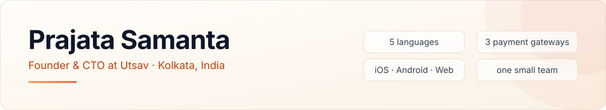

<picture>
  <source media="(prefers-color-scheme: dark)" srcset="header-dark.svg">
  
</picture>

Hi. I run engineering at [Utsav](https://utsavapp.in), where devotees across India book a puja from their phone, a temple performs it, and the video (and often the prasad) finds its way back to them. Small team, big surface: two mobile apps, a website, an admin platform, nine repos, shipping in Tamil, Telugu, Kannada, Hindi and English.

I like systems that keep working at 3 am, and tooling that gives the team an afternoon back.

## What's on my desk

- **Booking and payments** that survive three gateways, retries, refunds, and the occasional webhook that arrives twice.
- **Ops tooling** for a team that talks to customers on WhatsApp all day: call trackers, lead routing, payout reconciliation, schedule dashboards.
- **A video pipeline** that turns raw temple footage into a finished puja video without anyone sitting at a timeline.
- **An agent for every department.** More on that below.

## How I use AI, for real

Not demos. Things the team actually runs every week.

- One Claude Code agent per department: marketing, SEO, BI, support, ads, push. Each has its own context, prompts and skills, versioned in a repo like any other code.
- The monthly engineering report writes itself from the git history of every repo plus the team's daily log, then renders to a five-page PDF for the all-hands.
- The new-developer onboarding kit regenerates from the live code: ER diagrams checked against the models, ports, env names, versions. It is never stale on someone's first day.
- Before anyone touches an API shape or a database column, an agent traces the blast radius across all the repos and lists every consumer.
- In the product: puja and event copy drafted and translated into five languages, and support chat on WhatsApp and social, on a model-agnostic service. A human approves every word a customer sees.

The rule is simple. AI drafts, people decide, and everything it touches shows up in a diff.

## How I work

- PRD first. But the PRD is written from what the code does today, not from what we wish it did.
- Docs live in the repo as markdown, next to the code they describe. If it only exists in a chat thread, it doesn't exist.
- One repo, one branch, one PR. Anything that crosses repos gets its consumers listed before a line is written.
- Every user-facing string is a five-language change. No "we'll translate it later".
- Dense data, calm tables. Weight over colour.
- I'd rather read the log than the slide.

## Stack

| | |
|---|---|
| Apps | React Native + Expo, iOS and Android |
| Web | Next.js, React, Tailwind, Vercel |
| Services | Node.js + TypeScript on GKE · Python + FastAPI on Cloud Run |
| Data | Postgres on Cloud SQL, Redis |
| Async | AWS Lambda + SQS for webhooks and messaging |
| Payments | Razorpay, PayU, PhonePe |
| AI | Claude and Claude Code, Gemini, OpenAI |
| Earlier life | Android in Java and Kotlin, 2019 to 2023 |

## Two packages on npm

Both derived from MIT-licensed projects and adapted for my own needs: [image-stories](https://github.com/Prajata22/image-stories), from [react-insta-stories](https://github.com/mohitk05/react-insta-stories), and [i18n-next-export](https://github.com/Prajata22/i18n-next-export), from [next-export-i18n](https://github.com/martinkr/next-export-i18n).

## Say hi

[LinkedIn](https://www.linkedin.com/in/prajata-samanta) · [X](https://twitter.com/PrajataSamanta) · [utsavapp.in](https://utsavapp.in) · the company org, [@applex-in](https://github.com/applex-in)

The green squares below are mostly private repos under @applex-in.
